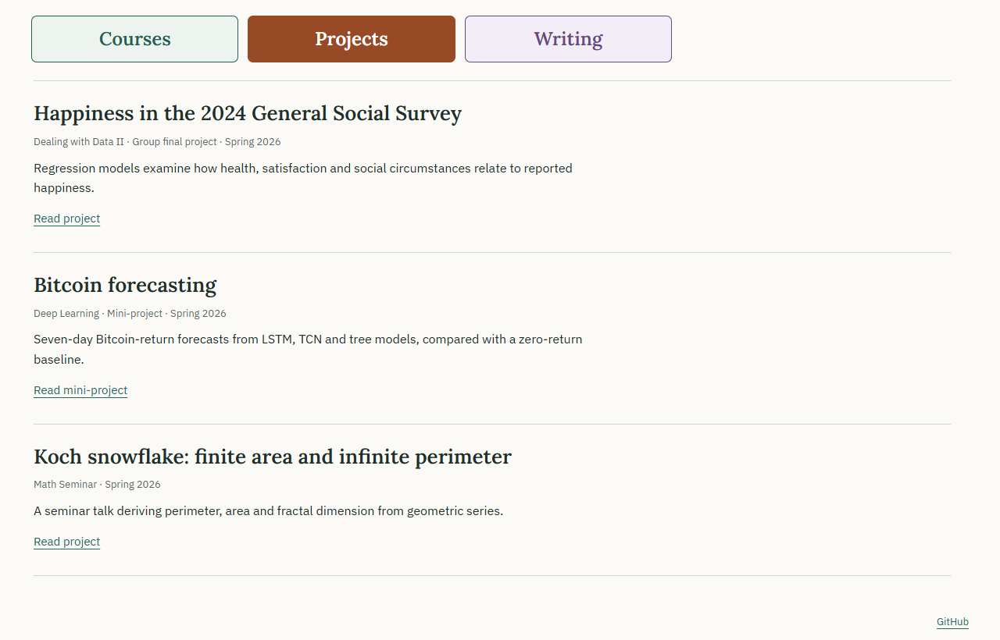

# Coursework

College projects, notes and essays in mathematics, computing, biology and philosophy.

[View the website](https://lacrimaeaware.github.io/coursework-showcase/)

[](https://lacrimaeaware.github.io/coursework-showcase/#projects)

## Examples, projects and writing

| Course or work | Contents |
| --- | --- |
| [Deep Learning](https://lacrimaeaware.github.io/coursework-showcase/courses/deep-learning/) | Classifiers, backpropagation, convolution, image regression, segmentation, detection and airline forecasting |
| [Dealing with Data II](https://lacrimaeaware.github.io/coursework-showcase/courses/dealing-with-data/) | R summaries, ANOVA, regression and predictor adjustment |
| [Systems biology](https://lacrimaeaware.github.io/coursework-showcase/courses/systems-biology/) | Enzyme kinetics, inhibition, lac feedback, basins, reaction events and product variability |
| [Number Theory](https://lacrimaeaware.github.io/coursework-showcase/courses/number-theory/) | Proof, induction, division, congruences, arithmetic functions and quadratic residues |
| [Calculus III](https://lacrimaeaware.github.io/coursework-showcase/courses/calculus-3/) | Vectors, arc length, curvature, motion and partial derivatives |
| [Programming Concepts](https://lacrimaeaware.github.io/coursework-showcase/courses/programming-concepts/) | Python programs using loops, functions, files, dictionaries, inheritance and SQLite |
| [Java Programming I](https://lacrimaeaware.github.io/coursework-showcase/courses/java/) | Methods, arrays, composition, validation and file output |
| [GSS happiness](https://lacrimaeaware.github.io/coursework-showcase/projects/gss-happiness/) | Group project using linear and logistic regression to examine reported happiness |
| [Bitcoin forecasting](https://lacrimaeaware.github.io/coursework-showcase/projects/bitcoin-forecasting/) | Seven-day return forecasts compared with a zero-return baseline |
| [Koch snowflake](https://lacrimaeaware.github.io/coursework-showcase/projects/koch-snowflake/) | Seminar presentation on perimeter, area, geometric series and fractal dimension |
| [Limited Terms for Limitless Concepts](https://lacrimaeaware.github.io/coursework-showcase/essays/eastern-philosophy/) | Eastern Philosophy essay about language and duality |
| [A Fool’s Guide to Tightrope Walking](https://lacrimaeaware.github.io/coursework-showcase/essays/holism-speech/) | Speech about holism and balance |

[All courses, 2022–2026](https://lacrimaeaware.github.io/coursework-showcase/history/)

## Local preview

Requires Node.js 22 or later. The build uses Node's standard library.

```sh
npm test
python -m http.server 4192 --bind 127.0.0.1 --directory dist
```

Open [the local collection](http://127.0.0.1:4192/).

`npm run build` copies `site/` into the ignored `dist/` folder, generates the
course overview and selected topic pages, and adds `.nojekyll`. `npm run check` checks the built pages' local links and anchors,
relative asset URLs, and source-file checksums. Browser layout and interaction
checks use `node tools/check_browser.mjs` while that server is running. Install
Playwright separately, or point `PLAYWRIGHT_MODULE` to an existing installation.
Browser screenshots and the report go in ignored `tmp/browser-expanded/`.

## Repository

| Directory | Contents |
| --- | --- |
| [content/](content/) | Course topics, examples, projects and essays |
| [site/](site/) | HTML, styles, scripts, figures and downloadable code |
| [tools/](tools/) | Build and validation scripts |
| [.github/workflows/](.github/workflows/) | GitHub Pages deployment |

The simulation Python scripts use NumPy, SciPy, and Matplotlib. Keep
`compare_enzyme_ode.py` beside `gillespie_demo.py`, and `MM_Heatmap.py` beside
`MM_Surface.py`, when downloading or running them.
The GSS R script requires prepared analysis data. Java examples were run with
OpenJDK 24.0.2. Python foundation programs use Python 3 and the standard library;
keep the bundle's file layout when running them.

## GitHub Pages

The workflow in `.github/workflows/pages.yml` builds and checks the source,
then publishes `dist/` through GitHub Pages when `main` changes.
